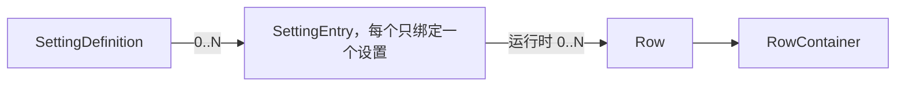

# Set-for-U 架构

Core、Android、Desktop 三个构建模块保持不变。Core 处理业务、条目、页面状态、兼容性与执行，平台实现界面和执行通道。Android 仍是标准应用模块，包名为 com.napreth.set4u，不再嵌套 app 或另建 server 模块。

| 模块 | 路径 | 职责 |
| --- | --- | --- |
| Core | set4u/core | 操作定义、Entry、Row、ViewModel、兼容规则、设备任务 |
| Android | set4u/android | Compose 宿主、Shizuku、本机 su、Manifest 与资源 |
| Desktop | set4u/desktop | Compose Desktop 宿主、ADB、经 ADB 的 su、桌面集成 |
| 共享界面源码 | set4u/ui | Compose 页面、主题组件、应用导航与会话生命周期 |

Core 的主要包为 settings、settings/presentation、viewmodel、localization、metadata、compatibility、execution、bridge、device 和 session。业务实现继续按功能放置，例如 network；设备任务可以留在所属业务目录，不强制集中到 device。共享 ViewModel 放在 viewmodel。

Android 和 Desktop 都使用 Compose。set4u/ui 是两个应用共同编译的源码目录，不依赖 Android 或 Swing API；三个构建模块保持不变。AppController 管理选项卡、页面导航、SettingsViewModel 和 Session 生命周期，AppPlatform 提供 Bridge、只读设备信息采集、外部链接、系统设置入口与本机配置读写。页面操作仍通过共享 ViewModel 提交，组件库不参与准入与执行。

“关于 → 应用设置 → 界面风格”提供 Google Material、Apple Cupertino、HyperOS Miuix、ColorOS COUI。ThemeComponents 将分组、条目、开关、输入、按钮和导航映射到对应组件库。所有下拉菜单由 AppController 保存状态，在主窗口内通过 AppMenuOverlay 渲染，避免独立 Popup 窗口不可见或夺走输入焦点。菜单按条目位置定位，支持返回键、Esc 和点击空白关闭；遮罩期间屏蔽底层页面的无障碍节点。Material、Cupertino 对话框同样在主窗口叠加，Miuix、COUI 使用库内浮层，仍放在对应 Scaffold 的 content 中注册宿主状态。Cupertino 的悬浮选项卡通过 Compose Backdrop 捕获页面图层，捕获对象不包含选项卡自身，不调用 View.draw 抓取正在绘制的 Compose 页面。低版本 Android 使用不透明底栏，支持的设备使用背景模糊和折射。

“关于”的“应用设置”包含界面风格、主题模式和应用语言，均使用锚定条目的下拉菜单。ThemeMode 支持 System / Light / Dark；AppLanguage 支持 System / zh-CN / en，解析后的 locale 传入共享 ViewModel 与应用文案表。切换语言保留 Session，下一次显示设备页面时以新 locale 创建 ViewModel。

HyperOS Miuix 和 ColorOS COUI 的普通条目通过组件库的内容槽设置常规字重，不使用库内固定为 Medium 的标题重载。字体由平台提供，Android 使用系统无衬线字体，桌面优先选择已安装的中文无衬线字体，避免中文落到宋体。两套库各自的字号、行高和标题层级继续保留；界面风格的存储 ID 仍为 miuix、coui。

外观是应用本机配置，不是被控设备的系统设置，不注册到 Core 的设置目录或兼容规则。Android 使用 SharedPreferences，桌面便携版保存在程序目录的 config/appearance.properties，开发启动保存在用户目录的 .set4u/appearance.properties。桌面写入先落临时文件再替换，写入失败保留原主题。主题变更只更新 AppState，不创建新 Bridge 或 Session，也不重新执行页面进入钩子；当前页面、返回历史、选项卡和设备状态继续保留。

## 设置项、条目和 Row

SettingDefinition 是操作层的规范定义，包含稳定 ID、值类型、选项 ID、输入约束、参数模式、默认 Handler 和具名操作工厂。这里不再放标题、说明或翻译。SettingsRegistry 对同 ID 的业务约束和实现做全局一致性检查，页面不能换掉后端；Handler 与工厂同时检查对象身份，不能用自定义 equals 冒充规范实现。

SettingEntry 是设置条目定义，每个 Entry 只绑定一个 SettingDefinition，一个设置可以没有 Entry，也可以有多个。Entry ID 与 Setting ID 分开；EntryRegistry 按 Entry ID 注册，页面引用已注册的对象。不同 Entry 可以有自己的 UiText 资源引用、选项标签、关键词、额外模板资源和 Row 生成方式，但共用设置状态、兼容规则和执行入口。没有界面的设置只注册 Definition 即可，不需要补一个空 Entry。



Row 只包含展示数据和界面意图，不持有 Definition、Handler 或执行闭包。SettingRow 的 control 可以是 Toggle、Value、Input、Choice、Selection 或 Action，rendererKey 可由页面指定私有样式。NavigationRow 保存页面或系统目的地。RowContainer 只是有序 Row 集合，不再设单选容器、复选容器或嵌套列表树；单选和复选都是普通 Selection Row。

EntryRow 把展示 Row 与 RowRequest 关联，但这份绑定留在 Entry 和 ViewModel 内部。平台只收到 SettingUiItem 的 Row、token、实际值和状态。一次点击可以对应固定值、编辑值或某个复选选项，平台不需要知道 Handler。

SettingsPage 每页一个类，声明 entries、layout(PageRows) 与 onEnter。PageRows.rows 从规范 Entry 取得 Row，并在 VM 内登记绑定；instance 可以给同一 Entry 的另一种呈现分配独立 Row ID。NavigationRow 可以展示某个 Entry 的值，但不能通过该行提交修改。未声明 Entry、重复容器、重复 Row 和无效导航均会拒绝发布，已有可写绑定随错误失效。

```kotlin
class DnsPage : SettingsPage("dns", UiText.Key("dns.title")) {
    override val entries = listOf(NetworkEntries.dnsMode)
    override fun layout(rows: PageRows) = listOf(
        RowContainer("dns.options", rows.rows(NetworkEntries.dnsMode)),
    )
}
```

Entry 应定义有实际用途的设置呈现，不为没有界面的设置创建空壳 Entry。运行时可以因数据为空或展示条件不满足而生成零个 Row，框架不限制最小数量，也不自动补占位。同一 Entry 可以用 EntryStyle.Dropdown 生成一个下拉 Row，也可以生成多个选择 Row，或用 Information 生成只读呈现。也可以为同一设置注册两个不同 ID 的 Entry，分别维护不同呈现。页面初始化按 Setting ID 去重读取，显示形式和 Entry 数量不会改变业务定义与共享状态的身份。

```kotlin
val summary = SettingEntry(language, UiText.Key("language.summary"), choices = labels, id = "language.summary")
val options = SettingEntry(language, UiText.Key("language.options"), choices = labels, id = "language.options")
```

## 动态数据与页面生命周期

DynamicSettingEntry 从业务查询服务接收 Flow<EntrySnapshot>。快照有递增 revision、可选 validUntilMillis，以及零个或多个运行时 EntryRow。空结果如何呈现由具体 Entry 或页面决定：可以显示“未扫描到 Wi-Fi”，也可以隐藏结果条目，仅保留页面上的“添加网络”。通用框架直接使用条目给出的 Row，不插入固定占位。Wi-Fi 的扫描结果、蓝牙设备等是运行时资源，不应按结果数量注册 Definition 或 Entry。来源可以是一次查询，也可以是页面可见期间的更新流；框架不要求单独建立数据源层。所有 Entry 的数据源在启动前都要通过能力检查，资源型快照自动受到版本与有效期约束。

每个快照、发布的容器、Row 列表和选项列表都复制后发布。参数化动作使用 SettingValue.ActionValue，Definition 的 actionParameters 声明允许的参数、必填约束和长度上限。参数集合不可变，默认字符串表示不打印值，执行证据仍遵守独立脱敏规则。

ViewModel 在首次加载时发布布局，再调用 onEnter，默认读取声明的 Entry。Entry 的 Flow 由页面作用域收集，进入钩子完成不需要等待流结束；刷新、关闭和模式切换会取消旧收集。新加载有独立代次，即使旧查询忽略取消，也不能覆盖新页面。

动态事件必须携带当前 Row token。token 包含页面代次、条目和数据版本，旧列表中的点击不能作用于复用 ID 的新 Row。提交时检查当前绑定与有效期，排队后在读取前和修改前再次检查；新快照、过期或页面关闭都能阻止尚未开始的旧操作。相同值但不同动态准入标识的请求不会错误共用 Deferred。静态页面关闭不会取消已经交给 Session 的普通修改。

动态列表不为过期自动启动后台计时服务，最终准入检查使用 Session 时钟。生产网络页保留系统的网络选择入口；DynamicEntriesTest 用三个网络验证模型、参数、版本失效和队列期限，没有把内存样例放入实际 UI。

## 文案与搜索

UiText.Key 引用 TextResources，UiText.Literal 用于动态名称或不需要翻译的数据。Entry 负责标题、说明、选项和关键词，容器及导航由页面引用资源。切换语言只改变资源解析，不重建不同标题的业务 Definition，因此不会破坏规范注册表的一致性。

exportUiMetadata 在编译后读取声明元数据，不连接设备、不收集 Entry Flow、不执行设置。输出位于 core/build/ui-metadata/<类型>/metadata，包含 texts.json、settings-index.json 和 settings-search.properties，随 Core JAR、桌面包和 APK 打包。新增动态模板的固定文本需要在 Entry.resources 中声明，SSID 等运行时值不进入导出。

静态搜索以 Entry ID 和 Setting ID 为身份，记录页面入口，跨全部语言和别名匹配。搜索器校验打包词表的元数据指纹，运行时扩展或自定义目录不匹配时使用其自身声明生成词表。session.search 返回结果时再做能力判断，默认排除确认不存在的功能；诊断入口可以显式 includeUnsupported。未知、权限不足及系统跳转仍是结果，不能按不支持直接丢弃。

## 兼容性和操作资格

compatibility 独立维护设备事实、静态版本规则、SupportProbe 和 CapabilityPolicy。DeviceSupport 回答功能或硬件是否存在，OperationAvailability 回答目前可采用的操作路径。界面呈现是第三件事，由 PageRows 的 UnsupportedVisibility 选择隐藏或保留确认不支持的 Row。

OperationAvailability 包含 Direct、RequiresPermission、RequiresPrivilege、Manual、Unavailable 和 Unknown。设备缺少 NFC 可以得到 DeviceSupport.Unsupported，普通设置页隐藏该行，诊断页仍可保留。命令权限不足、后端未实现、缺少授权或探测失败不会被标成硬件不存在。有系统回退目的地时，页面生成 NavigationRow，直接业务调用仍拒绝执行。

SupportProbe 可以按需检查运行时事实。当前 NFC、蓝牙使用已成功采集的 Package Manager feature 列表；读取失败保持 Unknown，不能把空输出当成没有硬件。已确认的支持事实在 Session 缓存，未知结果不缓存为否定结论。执行身份和权限单独读取，每次操作都重新评估，不能复用界面之前的可写结论。

CompatibilityRegistry 继续按稳定设置 ID 选择具名操作，明确 replaces 关系处理 ROM 覆盖，注册顺序不决定胜者。缺少必要事实、存在冲突或找不到实现分别保留原因。版本匹配只选择完整后端，不能代替修改前的状态和权限检查。厂商特制功能也需要 ROM、版本和能力范围，不能只凭所属厂商品牌判定支持。

DeviceProfile 从目标设备采集 getprop、uname、页大小及硬件 feature，记录来源与 Known、Unavailable 等状态。字段包括厂商、品牌、型号、产品与硬件标识、ROM 名称和版本、Android SDK、系统构建 ID、fingerprint、内核版本、安全补丁、SoC、ABI、基带和增量 OTA/SOTA 信息。厂商版本格式应提供专用解析器；dotted numeric 不能用于猜测所有 ROM 版本。

Wi-Fi 等能力的具体条件随版本与 ROM 变化。ADB 是通道，不能据此统一判定扫描必定不可用；root 也不保证绕过服务检查或 SELinux。操作应使用自己的策略和探测，依据见 [Android 扫描说明](https://developer.android.com/develop/connectivity/wifi/wifi-scan) 与 [AOSP WifiShellCommand](https://android.googlesource.com/platform/packages/modules/Wifi/+/refs/heads/android14-release/service/java/com/android/server/wifi/WifiShellCommand.java)。普通应用 API、Shell、Root、System 和系统跳转在模型上分别保留。

## Session、Bridge 与工作模式

CoreSession 固定绑定一个 Bridge 和目标执行环境，拥有 SettingsService、兼容性、搜索、共享状态、执行器和 ViewModel 工厂。设置状态由 Session ID、目标（含 Android 用户和包名）及设置 ID 标识。选择另一设备或工作模式时关闭旧 Session、创建新的 Bridge 与 Session，不热换旧会话中的身份。

IAdbBridge 提供 execute、openProcess、transfer、连接状态和 execution environment。BridgeTransport 区分 Adb、Shizuku、Local；ExecutionEnvironment 根据实际 UID 区分 App、Shell、Root、System、Unknown。传输名称不代表权限。默认身份查询通过 id -u 读取，不由 UI 自报身份。

Desktop 的 AdbBridge 固定 serial，命令使用 shell-v2，保留字节、stderr 和退出码；连接和文件传输通过 adb。Android 的 ShizukuBridge 使用非驻留 UserService、AIDL 和管道，绑定有独立代次，旧回调不能覆盖新连接。关闭只释放本客户端，不停止共享 ADB server、Shizuku 或其他客户端。

RootBridge 在通道上增加 root 身份，支持已有 UID 0、常规 su -c 和 AOSP su 0 sh -c。连接必须观察到 UID 0，每次命令也在实际执行进程中检查身份，失败不降回 shell。进程清理在同一 root 身份下执行，并保留 PID 启动时间核对。上传和下载使用 root 流式读写，部署仍经过临时文件、SHA-256 校验和原子替换。Desktop 为本机原子替换传入 Files.move；Android 使用文件系统 rename。

Android root 模式包装 LocalProcessBridge，本机普通应用进程只负责启动 su。Shell 模式使用 ShizukuBridge。Desktop 的 root 模式包装已连接的 AdbBridge。模式切换期间取消页面绑定，旧 Session 关闭后再建立新会话；失败时保留该模式的未授权状态，不自动用另一身份继续执行。

工作模式卡片依次显示模式下拉菜单、状态、授权操作。第三行左侧为“授权”，右侧为使用主题强调色的文字操作，没有按钮底色和边框，点击区域至少为 48dp。失败原因保存在页面状态中，右侧显示“重试”，不弹出错误对话框。重试清除旧原因，成功后显示“已启用”。选择 root 后增加“以 root 模拟 shell 身份”开关，模式与开关保存在平台本机配置中；切换任一项都会关闭旧 Session、重建 Bridge，观测和权限判断不能跨身份复用。桌面的目标序列号单独成组。

RootBridge 默认验证并使用 UID 0。显式开启 emulateShell 时仍先验证 root 授权，再探测 su 的 UID 2000 调用格式；只使用验证成功的格式执行，每个命令也检查 UID 2000。无法切换时连接失败，不改用 UID 0 完成设置。environment 返回实际的 Shell 身份，兼容性准入继续按实际身份判断。这是 shell UID 模拟，SELinux 域、附加组及挂载空间仍取决于 su 实现，不承诺与 adbd 完全相同。实现依据与参数说明可参阅 [Magisk su](https://topjohnwu.github.io/Magisk/tools.html#su) 和 [KernelSU su 实现](https://github.com/tiann/KernelSU/blob/main/userspace/ksud/src/su.rs)。

设备信息是工作模式选项卡中的独立子页，拥有返回导航和可取消的加载任务，页面先显示再采集。Android 使用应用 UID 读取本机公开的系统属性与内核信息，不请求 root 或 Shizuku；这条只读采集路径不参与系统设置操作。Desktop 读取当前 Session 所连接的目标，未连接时显示提示。子页、返回路径可以随 Activity 重建恢复，过期查询不能覆盖新 Session 或已经离开的页面。

Android 本机 su 的授权取决于设备上的 root 管理器。userdebug AVD 的 su 允许 shell 调用，并不等于允许普通应用调用；AVD 经 ADB 的 root 测试不能替代真机应用授权测试。

## 执行与状态

SettingsService 是统一业务入口，先解析规范 Definition、校验值或动作参数，再构造内部 SettingOperation。ExecutionEngine 不向平台公开。页面事件、直接业务 API 和兼容性适配最终进入同一条执行链。

执行顺序为资源准入、inspect、check、prepare、再次资源准入、apply、inspect、verify，失败时再 explain。prepare 在尚未尝试修改前重新检查身份、权限和所选后端，资格已改变时返回 Failed。实际修改后的读回和错误解释始终属于 Handler，页面没有独立 after 回调。若 apply 可能已经发生副作用，异常后仍尝试观测，无法确认时返回 Uncertain。

结果包含 AlreadySatisfied、Verified、Failed、PartiallyCompleted、Uncertain，以及前后观测、时间、证据和确定程度。退出码零不等于设置成功，不能在未知状态时显示关闭，也不能因验证失败盲目重试写入。

同一 Session 暂时串行读写，修改优先于排队查询。排队默认 5 秒，实际执行默认 30 秒，均可取消。排队超时的读取标记 Busy / readDeferred，保留上次实际值，不冒充不支持。静态的同设置同值请求可共用 Deferred，不同请求拒绝冲突；动态请求还比较准入标识。

页面只订阅声明的设置。默认缓存 512 项，未观察、没有活动操作的状态按最近访问与 5 分钟闲置期限清理，releaseTarget 可以显式释放。实际观测与 requestedValue 分开，进行中的开关保留实际值，完成后由读回更新。业务准入从 Session 最新状态读取，不依赖异步渲染是否已经收到新观测。

Shell 文本输出默认 stdout、stderr 合计 2 MiB，上限可配至 16 MiB，截断后继续排空，requireSuccess 拒绝截断数据。执行证据最多 32 条，默认不保存原命令、参数或原始输出；显式保留的诊断每路最多 512 字符。大型或二进制数据使用 openProcess。

关闭取消会话任务，在有限期限内清理设备任务、进程和 Bridge。无法及时完成的 IPC 或流关闭由独立清理协程承载，到期放弃等待；不能把调用方返回当成设备资源已确认回收。应用不提供常驻保活、策略维持或后台扫描服务。

## 设备任务与构建

设备代码必须是继承 DeviceTask 并带 @DeviceEntry 的类，Spec、请求和响应与实现分开。任务可以和业务放在同一目录，主机只引用 descriptor 和协议。简单命令直接通过 Bridge 执行，复杂 Android API 操作通过 DEX 任务完成。

buildDeviceTasks 扫描字节码，不执行任务来发现入口。它校验重复 ID、注解、构造函数、Spec 和依赖边界，生成注册表并运行 D8。宿主 JAR 剥离设备实现，设备产物包含 Kotlin 与协程运行库；当前不做 R8 缩减，反射和 JNI 仍需具体功能验证。API 37 作为编译平台，设备任务按自身要求校验运行版本。

DEX 以构建版本和 SHA-256 标识，在 Session 内只部署一次，验证后只读保存；每次调用仍启动独立 app_process，不建立常驻设备服务。任务请求、响应各限 1 MiB，stderr 限 8 KiB，调用结束清理临时进程组，会话关闭清理缓存。任务成功返回后，业务执行引擎仍要验证设置结果。

scripts/build.py 生成 Windows x64 ZIP、Linux x64 tar.gz 和 Android APK。基础版本 0.1.0；测试版名加 -debug，Android 使用测试签名，正式版不加后缀并输出 unsigned APK。桌面包带锁定版本与 SHA-256 的 Java 21 和 ADB。具体命令见 BUILDING.md。

## 平台与验证

MainActivity 只安装 Compose 内容、接入 Android 生命周期和平台能力。Desktop 使用一个承载 ComposePanel 的桌面窗口，没有 Swing 设置组件树。共享 Set4uApp 渲染“设置 / 工作模式 / 关于”和设置页面。连接、设备信息、外观、软件版本、更新、源码和许可证属于应用界面，不混入被控设备的设置目录。

Core 测试覆盖参数校验、规范注册、同一 Entry 的不同呈现、动态资源版本、过期和排队失效、跨语言索引、权限变化、页面取消及回读。BridgeContract 在选定 AVD 上验证 ADB、Shizuku，并可显式追加 UID 0 的 RootBridge，覆盖二进制、文件替换、超时、取消、DEX 与权限恢复。UI 冒烟验证网络列表、选项卡、工作模式和实际开关回读。

当前 WLAN、移动数据、蓝牙、NFC、飞行模式和私人 DNS 后端沿用原实现，静态 API 范围不等于所有 ROM 已验证。AVD 没有实际 NFC 与可用数据 SIM，正向 NFC、移动数据写入以及手机本机 su 授权仍需要对应硬件与真机环境。搜索资源与动态模型已经接通，实际扫描和连接业务按具体能力继续实现。
